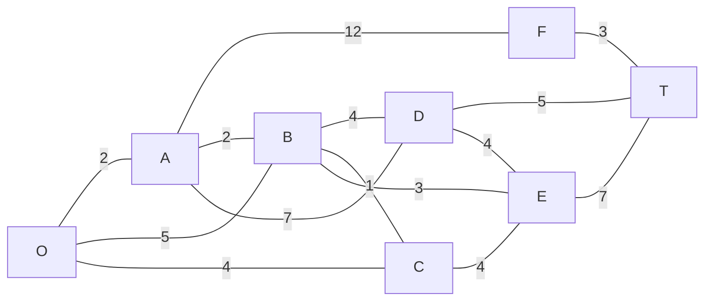

# Ibmec — Análise e Complexidade de Algoritmos (IBM3121)

| Campo | Valor |
|---|---|
| **Disciplina** | ANÁLISE E COMPLEXIDADE DE ALGORITMOS (IBM3121) |
| **Período** | 6º |
| **Professor** | Cassius Figueiredo |
| **Curso** | Engenharia de Computação/Software |
| **Semestre** | 2026.2 |
| **Avaliação** | AC |

---

## ATENÇÃO!

1. A tarefa deve ser executada em grupos de até 5 integrantes.
2. Toda a AC deve ser documentada e executada em linguagem (ou linguagens) de programação escolhida(s) pelo grupo.
3. Os nomes dos integrantes do grupo devem estar claramente indicados no artefato chamado "README.md" (instruções abaixo).
4. O projeto deve ser gerenciado utilizando infraestruturas Git/GitHub.
5. Ao terminar a execução das tarefas, apenas um dos integrantes do grupo deverá compartilhar o link para o repositório GitHub criado, por e-mail, com o professor (cassius.figueiredo@professores.ibmec.edu.br) até as **23h59 do dia 03/11/2026** (vale a data e o horário do e-mail). Coloque no assunto do e-mail a frase **"Entrega AC Complexidade Algoritmos"** para que o professor possa identificar facilmente a entrega e inclua no corpo do e-mail os nomes dos componentes do grupo. No caso de não-compartilhamento, compartilhamento incorreto ou falta da entrega, a nota ZERO será dada a todos os integrantes do grupo. Entregas com atraso serão descontadas da metade da nota dada ao grupo. Alunos que não estejam presentes no momento da apresentação terão sua nota individual reduzida à metade da nota dada ao grupo.
6. O repositório GitHub deverá, obrigatoriamente, conter um arquivo chamado "readme.md" em seu nível de arquivos raiz que inclua: nome e matrícula dos integrantes, nome do curso, disciplina e professor, quaisquer informações sobre a aplicação pedida que o grupo ache relevante e instruções detalhadas sobre como executá-la. A falta de informações necessárias para execução da aplicação renderá descontos substanciais na nota de todo o grupo.
7. Cada grupo apresentará sua aplicação em uma apresentação em sala, de no máximo 15 minutos, na primeira aula seguinte à data de entrega. Esta apresentação só poderá ser feita após a entrega da avaliação por e-mail. A ordem de apresentação será sorteada e cada grupo apresentará apenas para o professor.
8. Esta avaliação vale 20% da nota final.

---

# PROJETO SMARTNET — INFRAESTRUTURA DE CIDADES INTELIGENTES

Vocês foram contratados por um consórcio de tecnologia responsável por modernizar a infraestrutura de uma cidade inteligente. A cidade é dividida em várias zonas, bairros e centros de processamento, que precisam ser interligados fisicamente (vias) e digitalmente (fibra ótica).

Para gerenciar essa rede, o consórcio encomendou a vocês o desenvolvimento do **"SmartNet Analyzer"**, uma ferramenta de software capaz de mapear a cidade (tratada como um grafo, onde os vértices são os bairros/pontos de interesse e as arestas são as vias/conexões com seus respectivos custos ou distâncias) e executar análises críticas de conectividade e roteamento.

## 1. Requisitos Técnicos da aplicação ("SmartNet Analyzer")

Seu grupo deverá construir uma aplicação Web ou Stand-alone (na linguagem e framework de preferência do grupo) que atenda rigorosamente às seguintes especificações:

- **Interface (front-end):** a aplicação deve possuir uma interface gráfica amigável que suporte todas as funcionalidades exigidas, centralizando a operação do usuário.
- **Entrada de dados (mapeamento da cidade):** o usuário deve ser capaz de inserir o grafo que representa a cidade. A forma de entrada é livre (ex.: upload de um arquivo de texto, inserção manual de arestas/pesos via formulário, etc.), mas deve permitir a criação de grafos **direcionados e não-direcionados, com ou sem peso**.
- **Estruturação e exibição da memória:** o armazenamento interno do grafo na memória deverá ser feito obrigatoriamente utilizando as técnicas de **matriz de adjacência OU lista de adjacência, implementadas do zero pelo grupo**. O front-end deve possuir uma área que exiba visualmente como o grafo está armazenado na estrutura de dados escolhida.
- **Módulo de inteligência (algoritmos):** a partir do grafo inserido, o aplicativo deverá disponibilizar botões na interface para executar as seguintes operações:
  - **Busca em Profundidade (DFS):** utilizada para auditoria de rotas e verificação de conectividade geral ou becos sem saída.
  - **Busca em Largura (BFS):** utilizada para simular a propagação de ondas de rádio/alertas de emergência, encontrando o caminho mais curto de forma simplificada.
  - **Dijkstra:** utilizado para calcular a rota mais curta e rápida para veículos de emergência (ambulâncias, bombeiros) entre um ponto de origem e os demais bairros.
  - **Kruskal (árvore geradora mínima):** utilizado para calcular a rede de fibra ótica de menor custo possível que consiga interligar todos os bairros da cidade sem redundâncias caras.

## 2. Apresentação dos resultados

A execução de cada algoritmo não precisa gerar um desenho gráfico do grafo (embora seja um diferencial), mas deve obrigatoriamente apresentar os resultados no front-end em formato de texto/tabela de forma clara.

Ex.: uma representação simples de árvore para o DFS, a lista final representando a fila de execução do BFS, a lista final de distâncias a partir do nó inicial (para Dijkstra), ou a lista de arestas selecionadas e o custo total (para Kruskal).

## 3. A operação da aplicação

O sistema deve operar em loop interativo e o front-end deverá apresentar um botão **"Finalizar aplicação"**. Até que este botão seja pressionado, o usuário poderá apagar o grafo atual, inserir novos grafos e executar quantos algoritmos desejar.

Durante a apresentação a aplicação desenvolvida deverá executar corretamente todos os algoritmos para pelo menos um **grafo inédito proposto pelo professor**.

## 4. Entregáveis e critérios de avaliação

A nota do grupo será composta pela entrega do código fonte e por uma apresentação presencial explicando o mesmo. Os critérios avaliados serão:

1. **Correção algorítmica (40%):** o sistema implementa corretamente a estrutura de dados (lista/matriz) e os quatro algoritmos (DFS, BFS, Dijkstra, Kruskal)? Os resultados estão matematicamente corretos em grafos de teste propostos?
2. **Usabilidade e atendimento aos requisitos (30%):** a interface atende a todos os requisitos do escopo (inserção, visualização da estrutura, botões, clareza dos resultados, botão de finalizar)?
3. **Domínio da complexidade (20%):** durante a apresentação, o grupo deverá ser capaz de explicar a complexidade das soluções implementadas, justificando por que escolheram lista ou matriz de adjacência para este cenário.
4. **Apresentação (10%):** fluidez e domínio na apresentação da aplicação, domínio de aspectos técnicos utilizados e aderência ao tempo proposto de apresentação (tempo a ser controlado pelo próprio grupo).

---

## 5. Grafo de teste

A aplicação poderá ser testada por vocês, no seguinte grafo, para todos os algoritmos:

- **Tipo:** não-direcionado e ponderado
- **Vértices (8):** `O`, `A`, `B`, `C`, `D`, `E`, `F`, `T`
- **Arestas (14):**

| Origem | Destino | Peso |
|:---:|:---:|:---:|
| O | A | 2 |
| O | B | 5 |
| O | C | 4 |
| A | B | 2 |
| A | D | 7 |
| A | F | 12 |
| B | C | 1 |
| B | D | 4 |
| B | E | 3 |
| C | E | 4 |
| D | E | 4 |
| D | T | 5 |
| E | T | 7 |
| F | T | 3 |

### Lista de adjacência (referência)

```
O: A(2), B(5), C(4)
A: O(2), B(2), D(7), F(12)
B: O(5), A(2), C(1), D(4), E(3)
C: O(4), B(1), E(4)
D: A(7), B(4), E(4), T(5)
E: B(3), C(4), D(4), T(7)
F: A(12), T(3)
T: D(5), E(7), F(3)
```

### Representação do grafo (Mermaid)


